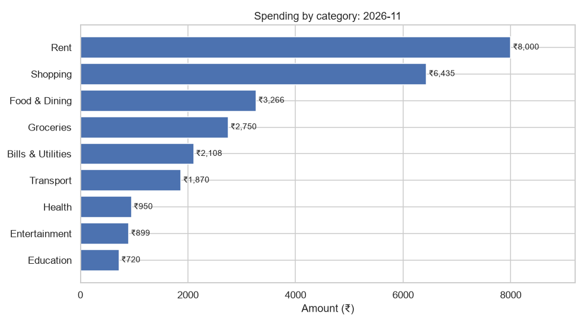
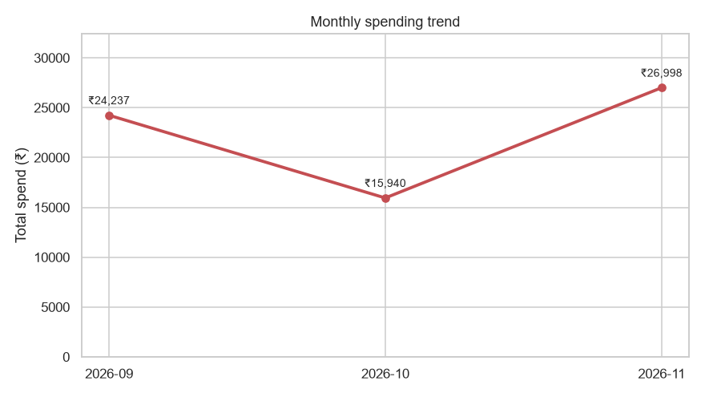
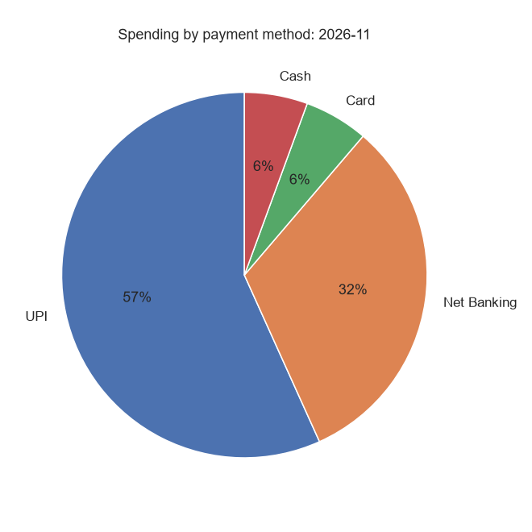
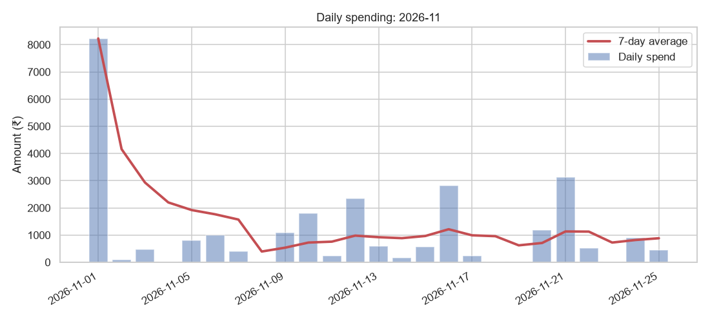
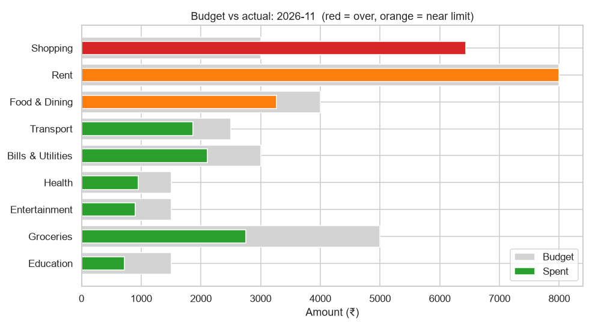

# 💸 Personal Expense Tracker with Data Visualization

A beginner-friendly **Python data-analysis project**. It loads expense records from CSV, **cleans messy data**, auto-categorises missing categories, analyses spending by category, month, payment method and day, checks **budgets**, generates **insights**, draws charts and saves reports. An optional **Streamlit dashboard** lets you explore everything interactively.

All data is **synthetic** (generated by the project), so there is nothing private to protect, and you can also use your own CSV.

## Problem Statement
Many people spend money without knowing *where* it goes. Bank statements are long and messy. This project turns raw transactions into clear numbers, charts and warnings so that spending can be understood and controlled.

## Industry Relevance
Data cleaning, aggregation, KPI design and visual storytelling are core skills for **Data Analyst, Business Analyst, Python Developer and Finance-related roles**. Fintech apps (budgeting tools, expense managers) use the same pipeline: import → clean → categorise → analyse → visualise → report.

## Features
- CSV loading with validation (missing columns give a clear message)
- **Cleaning:** bad dates, bad amounts (`"₹1,250"` → 1250), refunds/zero rows, duplicates, inconsistent category and payment names (`FOOD ` → `Food & Dining`, `upi` → `UPI`)
- **Rule-based categoriser** guesses a category from the description (Swiggy → Food & Dining)
- Analysis: category totals, monthly trend, payment methods, daily spending, highest category, average daily spend, month-over-month change, month-end projection, unusually large transactions (NumPy mean + 2×std)
- **Budget check** with OK / NEAR / OVER status
- Auto-written **insights** and savings rate
- 5 charts: category bar, monthly line, payment pie, daily trend (with 7-day average), budget vs actual
- Outputs: cleaned CSV, summary CSVs, text report, PNG charts
- Streamlit dashboard (upload a CSV, filter month and payment method) · 12 unit tests

## Tech Stack
Python 3.9+, pandas, NumPy, Matplotlib, Seaborn, datetime, argparse, Streamlit (optional), unittest

## Folder Structure
```
Personal-Expense-Tracker-Visualization/
├── data/        expenses.csv, budgets.csv (synthetic)
├── notebooks/   exploration.ipynb (optional exploring)
├── src/         config, generate_data, loader, categorizer, analyzer, budget, plots, reporter
├── outputs/     cleaned data, summary CSVs, chart PNGs
├── reports/     text reports
├── images/      screenshots for this README
├── docs/        guides and interview prep
├── tests/       unit tests
├── main.py      command-line entry point
├── dashboard.py Streamlit dashboard
├── requirements.txt
└── .gitignore
```

## Setup
```bash
git clone https://github.com/<your-username>/Personal-Expense-Tracker-Visualization.git
cd Personal-Expense-Tracker-Visualization

# Windows
python -m venv venv
venv\Scripts\activate
# macOS / Linux
python3 -m venv venv
source venv/bin/activate

pip install -r requirements.txt
```

## How to Run
```bash
python main.py --generate-data                  # create synthetic expenses.csv + budgets.csv
python main.py                                  # analyse the latest month
python main.py --month 2026-10                  # a specific month
python main.py --file data/my_expenses.csv --income 40000   # your own file
python main.py --no-charts                      # skip PNG charts
streamlit run dashboard.py                      # dashboard
python -m unittest discover -s tests            # tests
```

### Using your own data
Create a CSV with these columns: `date, category, amount, payment_method, description` (amounts positive). Leave `category` blank if you want the tool to guess it. **Do not upload real statements to GitHub** (`data/my_*.csv` and `data/real_*.csv` are git-ignored).

## Sample Output
```
==============================================================
 DATA CLEANING
==============================================================
 Rows read 124  ->  kept 119
 Dropped: 1 bad date, 1 bad amount, 1 refund/zero, 2 duplicate
 Category guessed from description for 4 rows

==============================================================
 EXPENSE SUMMARY: 2026-11  (month in progress: 25 of 30 days)
==============================================================
 Total spend      : ₹26,998  (39 transactions)
 Average per day  : ₹1,080
 Income / Savings : ₹35,000 / ₹8,002  (23% saved)

 SPENDING BY CATEGORY
   Rent                ₹    8,000   30%  ████████████████████
   Shopping            ₹    6,435   24%  ████████████████
   Food & Dining       ₹    3,266   12%  ████████
   Groceries           ₹    2,750   10%  ██████
   Bills & Utilities   ₹    2,108    8%  █████
   Transport           ₹    1,870    7%  ████
   Health              ₹      950    4%  ██
   Entertainment       ₹      899    3%  ██
   Education           ₹      720    3%  █

 BUDGET CHECK
   🔴 Shopping            ₹   6,435 / ₹3,000   214%  OVER
   🟠 Rent                ₹   8,000 / ₹8,000   100%  NEAR
   🟠 Food & Dining       ₹   3,266 / ₹4,000    82%  NEAR
   🟢 Transport           ₹   1,870 / ₹2,500    75%  OK
   🟢 Bills & Utilities   ₹   2,108 / ₹3,000    70%  OK
   🟢 Health              ₹     950 / ₹1,500    63%  OK
   🟢 Entertainment       ₹     899 / ₹1,500    60%  OK
   🟢 Groceries           ₹   2,750 / ₹5,000    55%  OK
   🟢 Education           ₹     720 / ₹1,500    48%  OK

 INSIGHTS
   • Highest spending category: Rent (₹8,000, 30% of spending).
   • Spending is up 69% vs 2026-10 (month still in progress, so this is not a full comparison).
   • At this pace you will spend about ₹32,398 by month end.
   • Over budget in: Shopping (+₹3,435).
   • Close to the limit: Rent, Food & Dining.
   • Most used payment method: UPI (57% of spending).
   • Highest-spend day: 21 Nov (₹3,123).
   • Savings rate: 23% (healthy: 20% or more).

==============================================================
 Report : /home/claude/Personal-Expense-Tracker-Visualization/reports/expense_report_2026-11.txt
 CSVs   : outputs/ (5 files)
 Charts : outputs/ (5 PNG files)
==============================================================
```

## Screenshots
| | |
|---|---|
|  |  |
|  |  |
|  |  |

## Learning Outcomes
Data cleaning with pandas · groupby/aggregation · working with dates and periods · NumPy statistics for outliers · designing KPIs and insights · data visualisation (Matplotlib/Seaborn) · budget logic · modular code and unit tests · building a Streamlit dashboard · Git/GitHub workflow

## Future Improvements
SQLite storage, bank/UPI statement importers, recurring-expense detection, ML category classifier (Naive Bayes), budget alerts by email, receipt OCR, multi-currency

> ⚠️ Educational project using synthetic data. Not financial advice.
